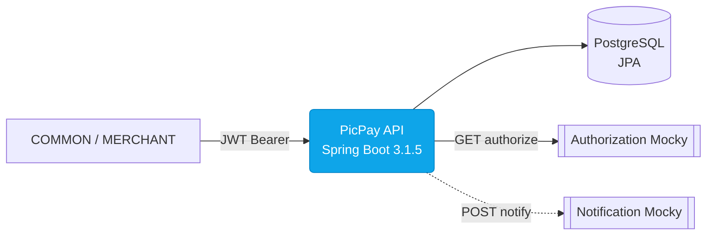
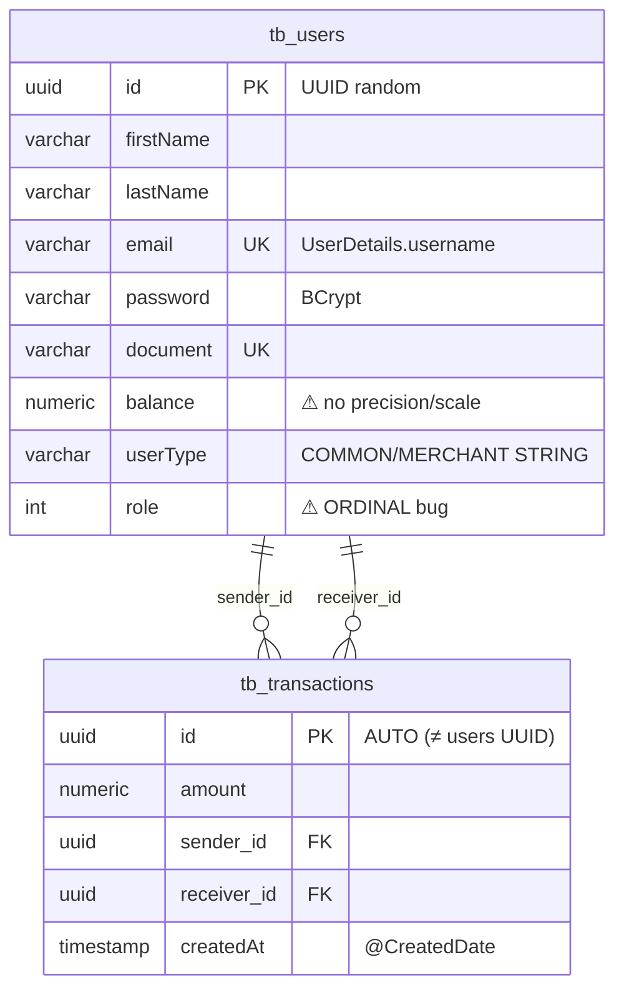

# PicPay Payment — Simplified Wallet API

<p align="center">
  
  
  
  
  
  
  
</p>

<p align="center">
  <b>Minimal, auditable clone of PicPay’s P2P wallet</b> — instant transfers with type-based rules, external authorization &amp; notification, JWT stateless auth, JPA persistence.<br/>
  <sub>Built against the official PicPay Backend Challenge · Interview-ready · Dockerized · Deep-documented</sub>
</p>

<p align="center">
  <a href="#-quick-start-5-min"><b>Quick Start</b></a> ·
  <a href="docs/diagrams/architecture.html">Architecture (Interactive)</a> ·
  <a href="docs/README.md">Docs Hub</a> ·
  <a href="#-api-reference">API</a> ·
  <a href="#-business-rules">Business Rules</a> ·
  <a href="#-security">Security</a>
</p>

---

## 📑 Table of Contents

- [At a Glance](#-at-a-glance)
- [Why this project?](#-why-this-project)
- [Quick Start — 5 min](#-quick-start--5-min)
- [Tech Stack](#-tech-stack)
- [Architecture](#-architecture)
- [Project Structure](#-project-structure)
- [API Reference](#-api-reference)
- [Business Rules](#-business-rules)
- [Security](#-security)
- [Data Model](#-data-model)
- [Configuration](#-configuration)
- [Testing](#-testing)
- [Deployment](#-deployment)
- [Roadmap & Gaps](#-roadmap--gaps)
- [Troubleshooting](#-troubleshooting)
- [Contributing](#-contributing)
- [License](#-license)

---

## ⚡ At a Glance

| Dimension | Value |
|---|---|
| **Language / Framework** | Java **17** · Spring Boot **3.1.5** (Spring 6.0.13, Hibernate 6.2, Jakarta EE 10) |
| **Persistence** | PostgreSQL 16 (prod) / H2 (test) · Spring Data JPA · `tb_users` / `tb_transactions` |
| **Auth** | Spring Security 6 · `java-jwt 4.4.0` HMAC256 · BCrypt · Stateless `JWTAuthMiddleware` (`OncePerRequestFilter`) · 2h expiry policy |
| **API style** | REST · MVC · Jackson · Jakarta Validation · `springdoc-openapi 2.2.0` (Swagger UI) — **remove `springfox 3.0.0` duplicate** |
| **External** | `RestTemplate → HttpGateway` → Authorization (`GET /authorize`) + Notification (`POST /notify`) via Mocky |
| **Containers** | `docker-compose` (api 8080 + postgres 5432 + pgAdmin 5050) · Paketo builder |
| **Tests** | JUnit 5 / Mockito / Spring Security Test — **coverage ~15% → target 80%** |
| **Docs** | `README.md` + 14 guides in `docs/` + explorable `docs/diagrams/architecture.html` |

> **Party-mode deep audit** by 6 specialists: `wilson-architect` · `tiago-dev` (java/spring) · `carla-qa` · `Atlas-DevOps` · `paige-tech-writer` · `maria-analyst/joao-pm`. All findings consolidated below & in `docs/`.

---

## 🎯 Why this project?

**For** Brazilians needing instant P2P value movement, **who** are `COMMON` individuals or `MERCHANT` shops, **the PicPay Simplified** is a wallet ledger API **that** enforces type-based invariants (merchants cannot send, balance checked, external authorization, notification), **unlike** generic CRUD, **it** encodes PicPay’s core business rules as executable **policies**.

Out-of-scope by design (MVP): KYC, Pix, fees, limits, reversal, idempotency, multi-currency — see [Roadmap](#-roadmap--gaps).

---

## 🚀 Quick Start — 5 min

### Prerequisites
`Java 17+` · `Maven 3.8+` · `Docker & Docker Compose` · `Git`

### 1 — Clone & env
```bash
git clone <repo> picpay-payment && cd picpay-payment/payment
cp .env.example .env
# edit .env → set JWT_SECRET (min 32 chars), keep defaults for local
cp .env.test.example .env.test  # H2 test DB
cat .env
```

**.env essentials**

| Key | Example | Used by |
|---|---|---|
| `AUTHORIZATION_API_URL` | `https://run.mocky.io/v3/9b89b419-a2f7-4885-aa86-5ddcea24d520` | `AuthorizationGatewayImpl` |
| `NOTIFICATION_API_URL` | `https://run.mocky.io/v3/54dc2cf1-…` | `NotificationGatewayImpl` |
| `DATABASE_URL` | `jdbc:postgresql://postgres:5432/picpay` | `application.properties` |
| `POSTGRES_USER/PASSWORD` | `admin/admin` | postgres service |
| `JWT_SECRET` | `gf928zRJbMrc6XkavpzEvuRsnOwok3f0` | `CryptographyConfig` HMAC256 |
| `PGADMIN_DEFAULT_EMAIL/PASSWORD` | `pgadmin4@pgadmin.org/admin` | pgAdmin |

### 2 — Run with Docker (recommended)
```bash
docker compose up --build
# api → http://localhost:8080
# pgAdmin → http://localhost:5050  (login with PGADMIN_* from .env)
# postgres → localhost:5432
# Swagger UI → http://localhost:8080/swagger-ui/index.html  (also /v3/api-docs)
```

### 3 — Run locally (no Docker, needs local Postgres)
```bash
# set DATABASE_URL to host postgres, e.g. jdbc:postgresql://localhost:5432/picpay
./mvnw spring-boot:run
# or
mvn spring-boot:run
```

### 4 — Smoke test
```bash
# 1) Register (ADMIN only — bootstrap via direct DB or make first user ADMIN)
curl -s http://localhost:8080/swagger-ui/index.html | head

# 2) Login → token (2h)
curl -s -X POST http://localhost:8080/auth/login \
  -H 'Content-Type: application/json' \
  -d '{"email":"alice@example.com","password":"secret123"}' | jq

# 3) Create transaction (needs EXECUTE_TRANSACTION)
TOKEN=... # from login response
curl -s -X POST http://localhost:8080/transactions \
  -H "Authorization: Bearer $TOKEN" -H 'Content-Type: application/json' \
  -d '{"value":10.00,"senderId":"<UUID>","receiverId":"<UUID>"}' | jq
```

> See [docs/api.md](docs/api.md) for full curl catalog & RBAC matrix, and [docs/configuration.md](docs/configuration.md) for profiles & env precedence.

---

## 🧱 Tech Stack

| Dependency | Version | Purpose | Verdict |
|---|---|---|---|
| `spring-boot-starter-parent` | **3.1.5** (Spring 6.0.13, Hibernate 6.2.9, Tomcat 10.1.15) | BOM | ⚠️ EOL 2024 (OSS window closed) → migrate to 3.4.x before 4 |
| `java.version` | **17** | LTS | ✅ OK, target **25** + virtual threads for Bradesco |
| `spring-boot-starter-web` | 3.1.5 | MVC + Jackson | ✅ |
| `spring-boot-starter-data-jpa` | 3.1.5 | Spring Data JPA | ✅ |
| `spring-boot-starter-security` | 3.1.5 | FilterChain, BCrypt | ✅ |
| `spring-boot-starter-validation` | 3.1.5 | Jakarta Validation 3.0 | ✅ |
| `postgresql` | 42.5.4 (managed) | JDBC | ✅ |
| `h2` | test | In-memory tests | ✅ |
| `lombok` | 1.18.30 | Boilerplate | ⚠️ `@EqualsAndHashCode(of=id)` risk with mutable entities |
| `spring-boot-starter-test` | *duplicated* | JUnit5/Mockito/AssertJ | ❌ declared **twice** — remove one |
| `com.auth0:java-jwt` | **4.4.0** | HMAC256 JWT | ✅ works; latest **4.5.2** (4.4.0 = Mar 2023); native `spring-security-oauth2-jose` alternative |
| `io.springfox:*` | **3.0.0 ×2** | Swagger 2 | ❌ **Incompatible with Boot 3 (javax)** — remove, keep springdoc |
| `org.springdoc:springdoc-openapi-starter-webmvc-ui` | **2.2.0** | OpenAPI 3 / Swagger UI | ✅ correct for Boot 3 |
| `spring-boot-devtools` | runtime optional | LiveReload | ⚠️ volume `.:/picpay` must not ship to prod |
| `RestTemplate` | — | HTTP gateway | ⚠️ maintenance-only (deprecated Spring 7.0) → `RestClient` (Spring 6.1+) + Resilience4j |

Details → [docs/tech-stack.md](docs/tech-stack.md)

---

## 🏛 Architecture

**Style:** Pseudo-hexagonal / layered hybrid. Intent: `domain` (pure) ← `application` (use-cases/policies) ← `infra` (adapters/config). Dependency leak: `application.policy.auth.NotRequireAuthInWhiteListPolicyImpl` imports `infra.config.security.SecurityConfig.WHITE_LIST`. Field injection dominates; no `ports` package (uses `gateways`/`services` as ports).

**Quality scores (wilson-architect):** Maintainability 6/10 · Testability 4/10 · Scalability ~100 TPS ceiling · Security 6/10. Path to Bradesco standards: Boot 4 + Java 25 + modular Flyway + `@Transactional` + WebClient + 80% coverage.

```
Host (docker-compose)
 ├─ api:8080  → Controllers → Services/UseCases → Policies → Gateways → JPA/Security
 ├─ postgres:5432 (tb_users, tb_transactions)
 └─ pgadmin:5050
External: Authorization API (Mocky) & Notification API (Mocky) via HttpGateway
```

**Interactive:** [docs/diagrams/architecture.html](docs/diagrams/architecture.html) — C4 L1/L2/L3, auth & transaction sequences, ERD, lifecycle, deployment hotspots (light/dark, SVG export).



Deep dive → [docs/architecture.md](docs/architecture.md) · ADRs → [docs/decisions.md](docs/decisions.md)

---

## 📂 Project Structure

```
payment/
├─ pom.xml                          # Boot 3.1.5, Java 17, deps
├─ docker-compose.yaml              # api + postgres + pgadmin
├─ Dockerfile                       # maven:3.8-openjdk-17-slim → mvn spring-boot:run (dev)
├─ .env / .env.example / .env.test
├─ src/main/java/com/picpay/payment/
│  ├─ PaymentApplication.java        # @SpringBootApplication
│  ├─ domain/                       # pure: entities·dto·repositories·services(ports)·gateways·policies(IF)
│  │  ├─ entities/{user,transaction,auth}  # User implements UserDetails; UserType COMMON/MERCHANT; Role/Permissions
│  │  ├─ dto/{user,transaction,auth,notification,error}
│  │  ├─ repositories/{UserRepository,TransactionRepository}
│  │  ├─ services/{TransactionService,UserService,AuthorizationService,NotificationService, auth/*}
│  │  ├─ gateways/{HttpGateway,AuthorizationGateway,NotificationGateway}
│  │  └─ policy/{transaction,auth/token,security}
│  ├─ application/                  # orchestration: controllers·services impl·usecases·policies impl
│  │  ├─ controllers/{App,User,Transaction,auth/Authentication}Controller
│  │  ├─ service/{Transaction,User,Authorization,Notification,auth/*}Impl
│  │  ├─ usecase/{transaction,authorization,auth/*,user,notification}
│  │  └─ policy/{transaction,auth,security}
│  └─ infra/                        # adapters & config
│     ├─ config/{AppConfig,security/*,docs/SwaggerConfig}
│     ├─ gateway/{generic/HttpGatewayImpl, AuthorizationGatewayImpl, NotificationGatewayImpl}
│     ├─ middleware/{auth/jwt/JWTAuthMiddleware, error/ControllerExceptionHandler}
│     └─ security/auditing/ApplicationAuditAware
├─ src/main/resources/application.properties        # dev profile, JPA update, external URLs
├─ src/test/  ~13 files  (data builders + 9 real tests)
├─ docs/  → hub + 14 guides + diagrams/architecture.html
└─ target/  (build output — ignored)
```

---

## 🔌 API Reference

Base: `http://localhost:8080` · Auth: `Authorization: Bearer <JWT>` (except whitelist) · Content: `application/json`

| Method | Path | Auth | RBAC | Body | Success | Notes |
|---|---|---|---|---|---|---|
| `GET` | `/` | no | `permitAll` | — | 200 | Health/root (whitelisted) |
| `POST` | `/auth/login` | no | `permitAll` | `LoginDTO {email,password}` | `LoginResponseDTO {token}` | JWT 2h, BCrypt check |
| `POST` | `/auth/register` | yes | `CREATE_USER` (ADMIN only) | `UserDTO` | `User` | Encrypts password via policy |
| `POST` | `/auth/logout` | yes | authenticated | — | 200 | `SecurityContextHolder.clearContext()` |
| `GET` | `/users` | yes | `hasAnyRole(USER,ADMIN)` | — | `List<User>` | Paginated? No — returns all ⚠ |
| `POST` | `/transactions` | yes | `EXECUTE_TRANSACTION` | `TransactionDTO {value,senderId,receiverId}` | `Transaction` | 5-step validate → atomic? see gaps |
| `GET` | `/transactions` | yes | `READ_TRANSACTION` | — | `List<Transaction>` |  |
| `GET` | `/v3/api-docs/**` etc | no | `permitAll` | — | OpenAPI JSON | Whitelisted Swagger |

**DTOs**

```java
record UserDTO(@NotBlank String firstName, @NotBlank String lastName,
  @NotBlank @Email String email, @NotBlank String document,
  @NotNull BigDecimal balance, @NotBlank @Size(min=3) String password,
  @NotNull UserType userType, @NotNull Role role) {}

record TransactionDTO(@NotNull BigDecimal value,
  @NotNull UUID senderId, @NotNull UUID receiverId) {}

record LoginDTO(@Email String email, String password) {}
```

**RBAC matrix**

| Permission | Role USER | Role ADMIN | Endpoint |
|---|---|---|---|
| `READ_USER` | ✓ | ✓ | `GET /users` (+ `ROLE_USER/ADMIN`) |
| `CREATE_USER` | — | ✓ | `POST /auth/register` |
| `EXECUTE_TRANSACTION` | ✓ | ✓ | `POST /transactions` |
| `READ_TRANSACTION` | ✓ | ✓ | `GET /transactions` |
| `DELETE_USER` etc | — | ✓ | (reserved) |

**Whitelist (no JWT):** `/`, `/auth/login`, `/v3/api-docs/**`, `/api-docs.yaml`, `/swagger-resources/**`, `/swagger-ui/**`, …

**Curl catalog**

```bash
# login
curl -X POST http://localhost:8080/auth/login -H 'Content-Type: application/json' \
  -d '{"email":"alice@example.com","password":"alice123"}'

# register (ADMIN token)
curl -X POST http://localhost:8080/auth/register \
  -H "Authorization: Bearer $ADMIN_TOKEN" -H 'Content-Type: application/json' \
  -d '{"firstName":"Bob","lastName":"Buyer","email":"bob@example.com","document":"12345678901","balance":100.00,"password":"bob123","userType":"COMMON","role":"USER"}'

# transact (COMMON sender)
curl -X POST http://localhost:8080/transactions \
  -H "Authorization: Bearer $TOKEN" -H 'Content-Type: application/json' \
  -d '{"value":25.50,"senderId":"<COMMON_UUID>","receiverId":"<MERCHANT_UUID>"}'

# list
curl http://localhost:8080/transactions -H "Authorization: Bearer $TOKEN"
curl http://localhost:8080/users -H "Authorization: Bearer $TOKEN"
curl http://localhost:8080/v3/api-docs -H "Accept: application/json" | jq
```

Swagger UI: `http://localhost:8080/swagger-ui/index.html` → [docs/api.md](docs/api.md) for screenshots & error table.

---

## 📜 Business Rules

Implementation enforces **invariants as policies** (Strategy):

| ID | Rule | Enforced by | Error | Tested? |
|---|---|---|---|---|
| **R1** | Merchant users **cannot send** transfers; only receive | `MerchantUserCantTransactPolicyImpl.execute(UserType)` → checks `== MERCHANT` | `Exception("Merchant User is not authorized to transact")` | ✓ `MerchantUserCantTransactPolicyTest` |
| **R2** | Sender must have **sufficient balance** (`balance >= value`) | `CannotTransactWithoutSufficientBalancePolicyImpl.execute(User, amount)` | `Exception("Balance is not enough")` | ✓ (2 cases) |
| **R3** | Transaction requires **external authorization** (`{message: Autorizado}`) | `AuthorizationService.isTransactionAuthorized()` → `IsAuthorizedUseCase` → `AuthorizationGateway.get()` | `Exception("Transaction Not Authorized, try again later...")` | ⚠ mocked true-only |
| **R4** | **Notification fire-and-forget** post-persist | `SendNotificationOnTransactPolicyImpl.execute(Transaction)` → `NotificationGateway.post()` | swallowed (no rollback) | ⚠ `assertDoesNotThrow` only |
| **R5** | Password **encrypted before registration** | `EncryptPasswordBeforeRegisteringUserPolicyImpl` → `BCryptPasswordEncoder` | — | ✗ |
| **R6** | JWT **expires in 2 hours** | `TokenMustExpiresInTwoHoursPolicyImpl` | — | ✗ |
| **R7** | Auth **not required on whitelist** | `NotRequireAuthInWhiteListPolicyImpl` + `SecurityConfig.WHITE_LIST` | 401 vs permitAll | ✗ (leak) |

**Flow (happy path):** `find sender → validate(R1+R2+R3) → find receiver → TransactionUseCase.execute() {sender.balance-=amount; receiver.balance+=amount} → save transaction + users → notify`.

> **Gaps (no R):** idempotency, reversal, limits/velocity, fees, audit, concurrent balance race (no `@Transactional` / `@Version`). See [docs/business-rules.md](docs/business-rules.md).

---

## 🔒 Security

| Layer | Mechanism | File | Notes |
|---|---|---|---|
| **AuthN** | Spring Security `DaoAuthenticationProvider` + `UserDetailsService` (findByEmail) | `infra/config/AppConfig.java` | `BCryptPasswordEncoder`, `AuthenticationManager` |
| **JWT** | `com.auth0:java-jwt 4.4.0` HMAC256, secret `${JWT_SECRET}` → `Algorithm` bean `@Lazy @Primary` | `infra/config/security/CryptographyConfig.java`, `application/service/auth/token/JWTService.java` | 2h expiry; `GetTokenFromHeaderUseCase` parses `Authorization: Bearer` |
| **Filter** | `JWTAuthMiddleware extends OncePerRequestFilter` → validate → `SaveAuthContextUseCase` → `SecurityContextHolder` | `infra/middleware/auth/jwt/JWTAuthMiddleware.java` | Skips whitelist via `NotRequireAuthInWhiteListPolicy` |
| **AuthZ** | `SecurityConfig.securityFilterChain()` — stateless, CSRF disabled, whitelist + method+path RBAC | `infra/config/security/SecurityConfig.java:WHITE_LIST` | `hasAnyRole(USER,ADMIN)`, `hasAuthority(EXECUTE_TRANSACTION …)` |
| **RBAC** | `Role.USER {READ_USER, EXECUTE_TRANSACTION, READ_TRANSACTION}`; `Role.ADMIN extends USER + {DELETE,CREATE,UPDATE}_USER`; `Permissions` enum → `SimpleGrantedAuthority` + `ROLE_*` | `domain/entities/auth/Role.java`, `Permissions.java` | `User.getAuthorities()` returns both |
| **Validation** | Jakarta Validation on DTOs (`@NotBlank @Email @Size @NotNull`) + `@Valid` in controllers | `domain/dto/*` | No `@Valid` on some endpoints? audit |
| **Error** | `ControllerExceptionHandler` → `ExceptionDTO` | `infra/middleware/error/ControllerExceptionHandler.java` | Generic `Exception` → 4xx/5xx mapping incomplete |

**Threats & fixes:** `Role` stored as `ORDINAL` (reorder = privilege escalation) → fix `@Enumerated(STRING)`; no rate-limit/brute-force; JWT secret from env not vault; `HttpGateway` has no timeout/circuit-breaker — see [docs/security.md](docs/security.md).

---

## 🗃 Data Model

**PostgreSQL · JPA/Hibernate 6 · `ddl-auto=update` (should be Flyway)**



`User @Entity(tb_users) @Table(tb_users)` `id @GeneratedValue(UUID)`, `document/email @Column(unique)`, `userType @Enumerated(STRING)`, `role @Enumerated` (ordinal!), `balance BigDecimal` (no `precision/scale`). `Transaction @Entity(tb_transactions)` `id AUTO`, `@ManyToOne sender/receiver`, `@CreatedDate LocalDateTime` (no `@Version`, no idempotency).

Deep dive + migration plan → [docs/data-model.md](docs/data-model.md)

---

## ⚙️ Configuration

| File | Profile | Key props |
|---|---|---|
| `src/main/resources/application.properties` | `dev` (hardcoded) | `app.security.token.secret=${JWT_SECRET}`, `app.external.api.authorization.url=${AUTHORIZATION_API_URL}`, `app.external.api.notification.url=${NOTIFICATION_API_URL}`, `spring.datasource.*` (Postgres), `hibernate.ddl-auto=update` |
| `src/test/resources/application-test.properties` | `test` | `jdbc:h2:mem:picpay` (overrides) |
| `.env` | host | real secrets (ignored) |
| `.env.test` | host | H2 creds |

Env precedence: `Docker compose env_file: [.env,.env.test]` (**bug: test leaks into prod**) → `System env` → `application.properties`. No `application-dev/prod.yaml`, no `management.*` actuator, no `logback-spring.xml`. See [docs/configuration.md](docs/configuration.md).

---

## 🧪 Testing

| Layer | Tests (9 real) | Coverage | Risk |
|---|---|---|---|
| `policy/transaction` | 3 (balance, merchant, notify) | ~75% | low |
| `repositories` | 2 (`@DataJpaTest` H2) | ~12% | high — only `findAll()!=null` etc |
| `service/*` | 4 mocked `@SpringBootTest` | ~35% | medium — happy path only |
| `controllers / security / jwt / gateways` | **0** | 0% | **critical** |
| **Overall** | **~12-18% est.** | **FAIL DoD 80%** | **REJECT** |

Run: `mvn test` (H2) · No `jacoco`, no `Testcontainers`, no `ArchUnit`, no `WireMock`. `PaymentApplicationTests.contextLoads()` smoke only. Builders in `src/test/java/data/*` use non-deterministic random. See [docs/testing.md](docs/testing.md) for P0/P1 plan (`@WebMvcTest` + `MockMvc` + `WireMock` + `Testcontainers` + Jacoco gate).

---

## 🚢 Deployment

```bash
docker compose up --build    # api 8080 / postgres 5432 / pgadmin 5050
# production hardening (P0):
# - pin postgres:16-alpine (not :latest), remove version: header, fix env_file split,
# - add .dockerignore, healthcheck, multistage Dockerfile, actuator /health
# - ignore .docker/postgres, set JWT_SECRET via vault
```

`.github/workflows/docker-publish.yml` builds GHCR image + cosign sign — not a CI gate. Missing: tests → build → scan → deploy, SBOM, Trivy. See [docs/deployment.md](docs/deployment.md) for compose fixes & GitHub Actions sketch.

---

## 🗺 Roadmap & Gaps

| Priority | Gap | Fix | Doc |
|---|---|---|---|
| **P0** | No `@Transactional` on `transact()` → partial commit | Add `@Transactional` + `@Version` optimistic lock | `architecture.md` |
| **P0** | `springfox 3.0.0` classpath clash | Remove, keep `springdoc 2.2.0` | `tech-stack.md` |
| **P0** | `Role ORDINAL` privilege escalation | `@Enumerated(STRING)` + Flyway V2 | `data-model.md` |
| **P0** | Coverage 15% < 80% gate | `MockMvc` + `WireMock` + Jacoco gate | `testing.md` |
| **P0** | Compose `env_file` leak + `postgres:latest` + `.docker/postgres` tracked | Fix compose, `.dockerignore`, `.gitignore` | `deployment.md` |
| **P1** | `ddl-auto=update` in prod | Flyway `V1__init.sql` | `data-model.md` |
| **P1** | No idempotency / double-spend race | `idempotencyKey` + DB constraint | `business-rules.md` |
| **P1** | `RestTemplate` no timeout/retry/circuit | `RestClient` + Resilience4j | `tech-stack.md` |
| **P2** | Boot 3.1.5 EOL + Java 17 | Boot 3.4.x → 4.x, Java 25 virtual threads | `decisions.md` |
| **P2** | No actuator/metrics/logs/rate-limit | `spring-boot-starter-actuator` + Micrometer | `configuration.md` |

Full ADRs (5) → [docs/decisions.md](docs/decisions.md) · Full quality heatmap → [docs/code-quality.md](docs/code-quality.md)

---

## 🛠 Troubleshooting

| Symptom | Cause | Fix |
|---|---|---|
| `FieldNotFound` on startup swagger | `springfox` + Boot 3 `javax→jakarta` | Remove `springfox` deps, keep `springdoc` |
| `invalid secret` / 401 always | `JWT_SECRET` not set or < 32 chars | `echo $JWT_SECRET` in container; regenerate |
| `Connection refused` to postgres | Compose health race | `depends_on` has no healthcheck → `docker compose logs postgres`, add `healthcheck: pg_isready` |
| H2 test passes, prod fails | `ddl-auto=update` drift | `mvn flyway:info`, add V1 |
| Balance negative after concurrent tx | No locking | Add `@Version` + retry, or `SELECT FOR UPDATE` |
| PGDATA committed to git | `.docker/postgres` tracked | `git rm -r --cached .docker/postgres`, add to `.gitignore` |
| Build bloat | Duplicate `spring-boot-starter-test` | Remove second declaration |

More → [docs/deployment.md#troubleshooting](docs/deployment.md) & [docs/development.md](docs/development.md)

---

## 🤝 Contributing

Branch → commit (`feat:`/`fix:`) → `mvn verify` (once Jacoco gated) → PR checklist (tests + docs + OpenAPI) → review.

See [docs/development.md](docs/development.md) for style (Lombok, MapStruct `from()` anti-`BeanUtils`, constructor injection), hooks, and PR template. `LICENSE` = MIT.

---

## 📚 Docs

| Guide | Path |
|---|---|
| **Hub** | [docs/README.md](docs/README.md) |
| Architecture | [docs/architecture.md](docs/architecture.md) |
| Tech Stack | [docs/tech-stack.md](docs/tech-stack.md) |
| Domain | [docs/domain.md](docs/domain.md) |
| API | [docs/api.md](docs/api.md) |
| Security | [docs/security.md](docs/security.md) |
| Business Rules | [docs/business-rules.md](docs/business-rules.md) |
| Data Model | [docs/data-model.md](docs/data-model.md) |
| Configuration | [docs/configuration.md](docs/configuration.md) |
| Deployment | [docs/deployment.md](docs/deployment.md) |
| Development | [docs/development.md](docs/development.md) |
| Testing | [docs/testing.md](docs/testing.md) |
| Code Quality | [docs/code-quality.md](docs/code-quality.md) |
| Decisions (ADRs) | [docs/decisions.md](docs/decisions.md) |
| **Interactive Diagrams** | [docs/diagrams/architecture.html](docs/diagrams/architecture.html) |

---

<p align="center"><sub>Generated 2026-08-31 · Stack: Java 17 · Spring Boot 3.1.5 · PostgreSQL · JWT HMAC256 · JPA · Docker · springdoc · Deep audit (party-mode: 6 specialists) · Economy OFF for docs</sub></p>
