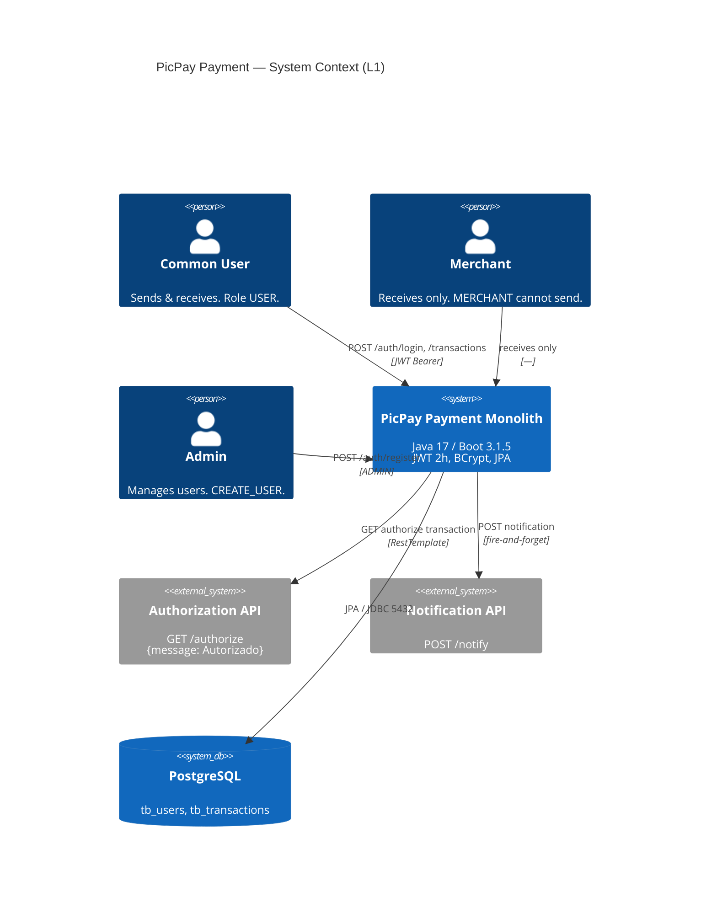
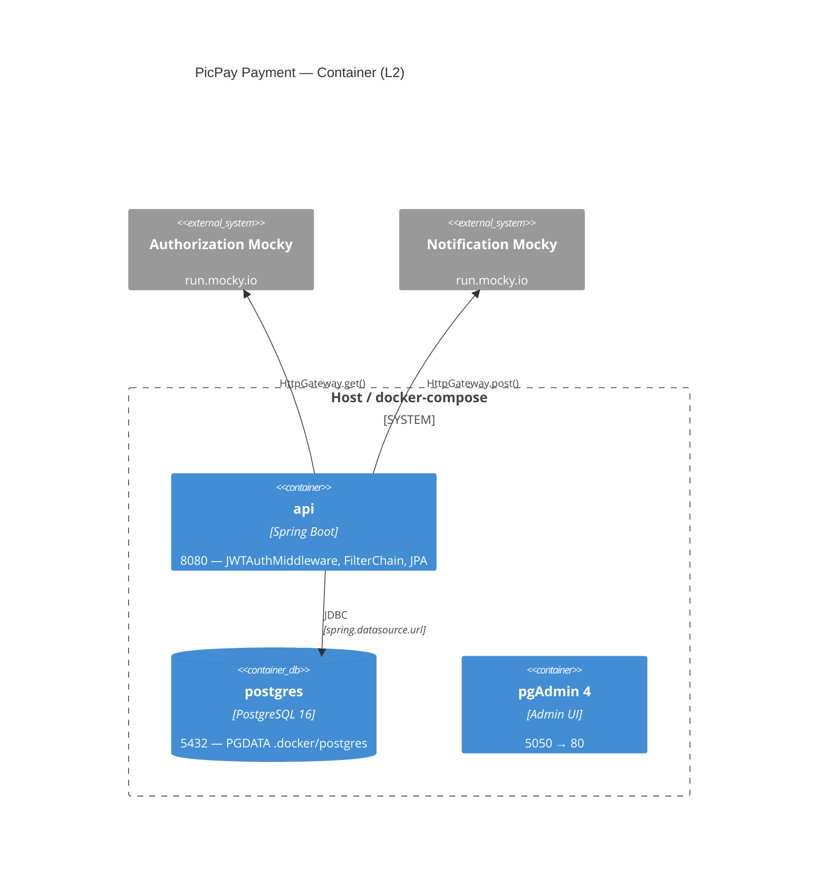

# Architecture — PicPay Payment

> **Owner:** wilson-architect (party-mode) · **Skills:** `java` + `spring` · **Stack:** Java 17 · Spring Boot 3.1.5 · Spring Security 6 · JPA/Hibernate 6 · PostgreSQL
> **Status:** Audited 2026-08-31 · Source: `pom.xml` · `src/main/java/com/picpay/payment/{domain,application,infra}`

---

## 1. Executive Summary

| Dimension | Observed | Verdict |
|---|---|---|
| **Style** | Pseudo-hexagonal / layered hybrid — folders `domain`/`application`/`infra` suggest Ports & Adapters | Intent hexagonal, reality **layered + anemic transaction script**. Domain ports exist (`services`, `gateways`, `policy` interfaces) but no `ports` package, and upward leak: `application.policy.auth.NotRequireAuthInWhiteListPolicyImpl` → `infra.config.security.SecurityConfig.WHITE_LIST` |
| **Language** | Java 17 LTS (records unused) | OK, **2 LTS behind Bradesco target 25** (no virtual threads / pattern matching) |
| **Framework** | Spring Boot 3.1.5 (Spring 6.0.13, Jakarta EE 10, Hibernate 6.2.9) | EOL 2024 (OSS window closed) — migrate to 3.4.x before 4 |
| **Packaging** | Single module `com.picpay:payment:0.0.1-SNAPSHOT` fat jar via `spring-boot-maven-plugin` + `paketobuildpacks/builder:jammy` | Monolith, no modulith boundaries |
| **DB** | PostgreSQL (prod) + H2 (test), JPA, `ddl-auto=update`, `PostgreSQLDialect` | Anti-pattern without Flyway/Liquibase |
| **Security** | `spring-boot-starter-security` + `java-jwt 4.4.0` custom `OncePerRequestFilter`, BCrypt, stateless JWT 2h | Custom JWT, not Spring Authorization Server; `@Lazy @Primary HMAC256` smells |
| **Docs** | Duplicated `springfox 3.0.0` + `springfox-ui` **and** `springdoc 2.2.0` · `SwaggerConfig` commented ("not compatible with Boot 3") | Bloat, classpath conflict — remove springfox |
| **External** | `RestTemplate → HttpGateway → AuthorizationGateway + NotificationGateway` | No timeout/retry/circuit breaker; `RestTemplate` deprecated |
| **Testing** | `spring-boot-starter-test` duplicated + `spring-security-test`, H2, 9 real tests | ~15% coverage — no contract/ArchUnit |
| **Ops** | `docker-compose.yaml` (api+postgres+pgadmin), `.env` templating | No actuator/health/metrics, Dockerfile mounts source in prod |

**One-liner:** *Clean layering intention with Policy/UseCase/Gateway patterns undermined by field injection, missing `@Transactional`, deprecated deps, and infra→domain cyclic leaks. Ceiling ~100 TPS without rewrite.*

---

## 2. C4 Model

### L1 — System Context



### L2 — Container (Docker Compose)



> Interactive container & deployment notes: [docs/diagrams/architecture.html#c4-container](diagrams/architecture.html#c4-container)

### L3 — Component (Layered)

```
domain/                      pure — no Spring
 ├─ entities/user     User implements UserDetails · UserType {COMMON,MERCHANT} · Role {USER,ADMIN} · Permissions (8)
 ├─ entities/transaction Transaction {sender,receiver,amount,createdAt}
 ├─ dto               UserDTO, TransactionDTO, LoginDTO, NotificationDTO, ExceptionDTO (Jakarta Validation)
 ├─ repositories      UserRepository, TransactionRepository (Spring Data JPA interfaces)
 ├─ services (ports)  TransactionService, UserService, AuthorizationService, NotificationService, auth/* (interfaces)
 ├─ gateways (ports)  HttpGateway, AuthorizationGateway, NotificationGateway (interfaces)
 └─ policy (IF)       5 interfaces

application/                 orchestration — @Service / @Component / @RestController
 ├─ controllers       App, User, Transaction, auth.Authentication
 ├─ service impl      TransactionServiceImpl (validate + transact), UserServiceImpl, auth/JWTService …
 ├─ usecase (15)      TransactionUseCase {subtract/add}, SaveTransaction, FindAll, AuthenticateUser, GenerateJWT …
 └─ policy impl       5 @Component

infra/                       adapters & config
 ├─ config            AppConfig (RestTemplate, UserDetailsService, BCrypt, DaoAuthProvider), security/SecurityConfig, CryptographyConfig
 ├─ gateway impl      HttpGatewayImpl (@Primary RestTemplate), AuthorizationGatewayImpl, NotificationGatewayImpl
 ├─ middleware        auth/jwt/JWTAuthMiddleware (OncePerRequestFilter), error/ControllerExceptionHandler
 └─ security/auditing ApplicationAuditAware
```

**Dependency direction (intended vs actual):** Intended `infra → application → domain`. Actual `application.policy.auth` → `infra.config.security.SecurityConfig.WHITE_LIST` (upward leak) + `infra.config.AppConfig` → `domain.repositories.UserRepository` (correct: infra depends on domain). Field `@Autowired` dominates — violates DIP.

---

## 3. Patterns Catalog

| Pattern | Where | Purpose | Quality |
|---|---|---|---|
| **Policy (Strategy)** | 5 pairs `domain/policy/*` IF + `application/policy/*Impl` | Encodes invariants (merchant, balance, notify, encrypt, token expiry) as swappable strategies | Good SRP, but tested only 3/5; one leaks to infra |
| **UseCase (Transaction Script)** | `application/usecase/*` (15) `@Component` | Single-method executors (e.g. `TransactionUseCase.execute()` subtract/add) | Anemic — no domain behavior on entities |
| **Gateway (Port/Adapter)** | `domain/gateways/*` + `infra/gateway/*Impl` | Abstracts external HTTP (HttpGateway generic → Authorization/Notification) | Clean, but `HttpGatewayImpl.put/patch/delete` return `null` stubs |
| **DTO + Record** | `domain/dto/*` Java records + Validation | API contract, no entity exposure | Good; `BeanUtils.copyProperties` in `User.from()` is anti-pattern |
| **Filter Chain** | `JWTAuthMiddleware` + `SecurityConfig` | Stateless JWT validation before `UsernamePasswordAuthenticationFilter` | Standard Spring Security 6 style |
| **Auditing** | `ApplicationAuditAware` + `@CreatedDate` | JPA auditing (but only Transaction uses `@CreatedDate`) | Incomplete — User missing timestamps |

---

## 4. Request Lifecycle

```
HTTP → JWTAuthMiddleware (skip whitelist? → NotRequireAuthInWhiteListPolicy)
  → SecurityFilterChain (csrf disable, authorizeHttpRequests, session STATELESS, DaoAuthProvider, logout /auth/logout)
    → Controller (@Valid DTO)
      → Service.validate() [Merchant? → Balance? → isAuthorized?]
        → Service.transact() [find sender/receiver → TransactionUseCase → save Tx + update balances → SendNotification]
          → JPA Repository → PostgreSQL
            ← Response (Transaction / ExceptionDTO via ControllerExceptionHandler)
```

*Auth snippet* (`SecurityConfig.java:37-55`): whitelist 9 paths permitAll; `GET /users` → `hasAnyRole(USER,ADMIN)`; `POST /auth/register` → `hasAuthority(CREATE_USER)` (ADMIN); `POST /transactions` → `EXECUTE_TRANSACTION`; others `authenticated()` → `STATELESS` + `JWTAuthMiddleware` before `UsernamePasswordAuthenticationFilter`.

---

## 5. Implicit ADRs

| # | Decision | Context | Decision | Consequence |
|---|---|---|---|---|
| **ADR-1** | Stateless JWT with `java-jwt 4.4.0` HMAC256 | Need stateless auth for SPA/mobile, Boot 3.1 | Custom `JWTAuthMiddleware` + `TokenService` vs Spring Authorization Server | Simple, but reinvents JWK/refresh; `@Lazy @Primary Algorithm` bean, 2h policy hard-coded, no refresh/rotation |
| **ADR-2** | Layered hexagonal-ish (domain/application/infra) | Bradesco hexagonal standard | Folders as boundaries, UseCase + Policy + Gateway patterns | Good DDD intent, but no ArchUnit enforcement → leaks & field injection |
| **ADR-3** | JPA `ddl-auto=update` over Flyway | Rapid prototyping for challenge | Hibernate auto-DDL in `application.properties` | Fast, but unsafe for prod (drift, no versioned migrations) |
| **ADR-4** | `RestTemplate` via `HttpGateway` | External Mocky calls | `RestTemplate` `@Primary` + generic `HttpGateway` interface | Deprecated; no timeout/retry/circuit → fragility |
| **ADR-5** | Springfox + Springdoc coexistence | Migration Boot 2→3 | Keep both deps, comment `SwaggerConfig` with "not compatible (javax vs jakarta)" | Classpath bloat, Guava conflict, 18 MB waste — should remove springfox |
| **ADR-6** | H2 for tests, PostgreSQL for prod | Fast integration tests | `DataJpaTest` on H2, `application-test.properties` H2 mem | Divergence (dialect, locking) → false confidence |

---

## 6. Scalability & Quality Assessment

| Quality | Score | Rationale |
|---|---|---|
| **Maintainability** | **6/10** | Clear layering & policies help; hurt by `@Autowired` fields, `BeanUtils`, missing constructor injection, DTO↔entity mapping scattered |
| **Testability** | **4/10** | 15% coverage, no controller slice tests, policies partly tested, gateways untested, H2 vs PG gap |
| **Scalability** | **~100 TPS ceiling** | No connection pool tuning, no caching, no async notification, blocking RestTemplate, no `@Transactional` → no DB-level concurrency control, no horizontal session (stateless helps) |
| **Security** | **6/10** | BCrypt + JWT + RBAC correct; `Role ORDINAL` bug, whitelist leak, default `admin/admin`, no rate-limit, no CORS hardening |
| **Operability** | **3/10** | No actuator/health/metrics/logs, PGDATA tracked, no migrations, no CI gate |

---

## 7. Recommendations (to Bradesco standards)

**P0 (must before prod):** Remove `springfox` deps; add `@Transactional` to `TransactionServiceImpl.transact()` + optimistic lock; fix `Role @Enumerated(STRING)`; split `env_file` in compose; pin `postgres:16-alpine`; `.dockerignore` + ignore `.docker/postgres`.

**P1:** Add `Flyway` `V1__init.sql`; migrate `RestTemplate → RestClient` + `Resilience4j` timeout/retry/circuit; add `idempotencyKey` + DB unique constraint; BigDecimal `precision=19, scale=2`; `ArchUnit` to enforce `domain → application → infra` dependency.

**P2:** Upgrade Java 17 → 25 (virtual threads), Boot 3.1.5 → 3.4.x → 4.x; add `spring-boot-starter-actuator` + Micrometer/Prometheus; Testcontainers for PG; `MapStruct` over `BeanUtils`; constructor injection via `@RequiredArgsConstructor`.

---

## 8. See Also

- [Tech Stack](tech-stack.md) — dependency table & version rationale
- [Domain](domain.md) — entities, enums, DTOs detail
- [Data Model](data-model.md) — ERD + Flyway plan
- [Security](security.md) — filter chain & threat model
- [Decisions](decisions.md) — 5+ ADRs expanded
- Interactive: [diagrams/architecture.html](diagrams/architecture.html)

