# Business Rules — PicPay Simplified

> **Source:** `application/policies/**` · `application/usecases/**` · `application/services/**` · `domain/entities/user/UserType.java` · `infra/gateways/**` · **Challenge:** *official PicPay Backend Challenge* (see [Domain](domain.md))

---

## 1. Invariants (R1–R7)

| ID | Rule | Enforcer | Failure | HTTP |
|---|---|---|---|---|
| **R1** | **Merchant cannot send** — `UserType.MERCHANT` cannot be `senderId` | `MerchantUserCantTransactPolicyImpl.isTrue(User sender)` (`sender.userType == MERCHANT`) | `Exception("Merchant User is not authorized to transact")` | `403` |
| **R2** | **Sufficient balance** — `sender.balance >= transaction.value` (strict `BigDecimal` compare) | `CannotTransactWithoutSufficientBalancePolicyImpl.isTrue(BigDecimal balance, BigDecimal value)` | `Exception("Balance is not enough to complete the transaction")` | `400` |
| **R3** | **External authorization required** — Mocky must return `{message:"Autorizado"}` | `AuthorizationService.isTransactionAuthorized()` → `AuthorizationGateway.isAuthorized()` → `HttpGateway GET app.external.api.authorization.url` | `Exception("Transaction Not Authorized, try again later...")` | `403` |
| **R4** | **Both parties exist** — sender & receiver must exist | `FindUserByIdUseCaseImpl.findById()` | `UsernameNotFoundException("User not found")` | `404` |
| **R5** | **Positive amount** — `value > 0` | `TransactionDTO/@NotNull` only — **missing** `@Positive` — 0/negative currently passes → add `@Positive` | `400` (once fixed) | `400` |
| **R6** | **Distinct parties** — sender ≠ receiver | **Not enforced** — same UUID passes → should reject | — | `400` (to add) |
| **R7** | **Notification best-effort** — after commit, `POST notification.url {email,message}` via `NotificationGateway` | `SendNotificationOnTransactPolicyImpl.afterTransacting(Transaction)` → `NotificationService` → `HttpGateway` | Exception **swallowed** (logged), does not roll back tx | — |

Rules R1–R3 are orchestrated in `TransactionServiceImpl.validate(sender, amount)` **before** debit; R7 runs **after** `TransactionUseCase.execute()`.

---

## 2. Entity invariants

### User

| Field | Constraint | Notes |
|---|---|---|
| `email` | unique, `@Email @NotBlank` | used as JWT subject |
| `document` | unique (CPF/CNPJ), `@NotBlank` | no format check — add `@CPF`/`@CNPJ` or regex |
| `balance` | `BigDecimal`, default 0, scale 2 expected | DB column has no `precision/scale` — add `@Column(precision=19,scale=2)` |
| `userType` | `COMMON \| MERCHANT` | drives R1 |
| `role` | `USER \| ADMIN`, `@Enumerated(ORDINAL)` — **bug**: ordinal fragile → change to `STRING` | drives RBAC |
| `password` | BCrypt hashed via policy | raw DTO has `@Size(min=3)` only — add strength rule |

### Transaction

| Field | Constraint | Notes |
|---|---|---|
| `amount` | immutable, `value` from DTO | field named `amount` but DTO is `value` — rename align |
| `sender` / `receiver` | `@ManyToOne` User | balances updated in `TransactionUseCaseImpl` (no `@Transactional`) |
| `createdAt` | instant set at execution | no `@CreationTimestamp` — set manually |

---

## 3. Transaction Lifecycle (state: implicit, not persisted)

```mermaid
stateDiagram-v2
  [*] --> REQ: POST /transactions {value,senderId,receiverId}
  REQ --> VALIDATING: TransactionService.validate()
  VALIDATING --> REJECTED_MERCHANT: R1 true
  VALIDATING --> REJECTED_BALANCE: R2 true
  VALIDATING --> REJECTED_AUTH: R3 false
  VALIDATING --> DEBITING: all pass
  DEBITING --> CREDITING: sender.balance -= value; save sender
  CREDITING --> PERSISTED: receiver.balance += value; save receiver; save Transaction
  PERSISTED --> NOTIFYING: SendNotificationOnTransactPolicy afterTransacting()
  NOTIFYING --> DONE: swallow failure
  DONE --> [*]
  REJECTED_MERCHANT --> [*]
  REJECTED_BALANCE --> [*]
  REJECTED_AUTH --> [*]
```



**Gaps:** no states persisted; no idempotency key; no reversal/compensation. Concurrent transfers can overdraw (lost update) — see race below.

---

## 4. Race & Consistency

`TransactionUseCaseImpl.execute()` does **three writes** without `@Transactional` and **no row lock**:

```java
sender.setBalance(sender.getBalance().subtract(value));
receiver.setBalance(receiver.getBalance().add(value));
userRepository.save(sender); userRepository.save(receiver);
transactionRepository.save(new Transaction(amount,sender,receiver, now));
```

Under concurrent `POST /transactions` for same sender, `read → subtract → save` can interleave → **overdraft**. Fix: `@Transactional` + `SELECT ... FOR UPDATE` (`@Lock(PESSIMISTIC_WRITE)` on `findById`) or `@Version` optimistic lock. Also add DB `CHECK (balance >= 0)`.

Add **idempotency**: `Idempotency-Key` header → dedup table with unique `key + senderId` + 24h TTL; return cached response on retry.

---

## 5. Notification Rule (R7)

- **Trigger:** after transaction persisted, `policy.afterTransacting(tx)` → `NotificationGateway.send({email,message})` where `email` = sender+receiver? `NotificationData` currently holds one email — should send two.
- **Transport:** `HttpGateway.post(notification.url, notification)` — no timeout/retry/circuit breaker.
- **Semantics:** fire-and-forget; `try/catch` inside policy → failure logged but not propagated, not retried. Acceptable for MVP; prod → outbox + async retry.
- **Failure modes:** network error, 5xx, timeout — all swallowed. Add **retry with exponential backoff** + dead-letter queue.

---

## 6. Authorization Mock (R3)

- **URL:** `app.external.api.authorization.url` = `https://run.mocky.io/v3/9b89b419-a2f7-4885-aa86-5ddcea24d520` (classic challenge mock). Returns `{message:"Autorizado"}` or `{message:"Não Autorizado"}`.
- **Gateway:** `AuthorizationGatewayImpl.isAuthorized()` does `httpGateway.get(url, AuthorizationResponse.class)` and checks `message.equals("Autorizado")`. No timeout → can hang. Add `RestTemplateBuilder.setConnectTimeout(1s).setReadTimeout(2s)` + resilience4j.
- **Kill-switch:** if Mocky down, **all transactions fail closed** (403). Consider cache or fallback.

---

## 7. See Also

- [Domain](domain.md) — entities & challenge narrative
- [API](api.md) — request/response + error codes
- [Data Model](data-model.md) — table constraints to add
