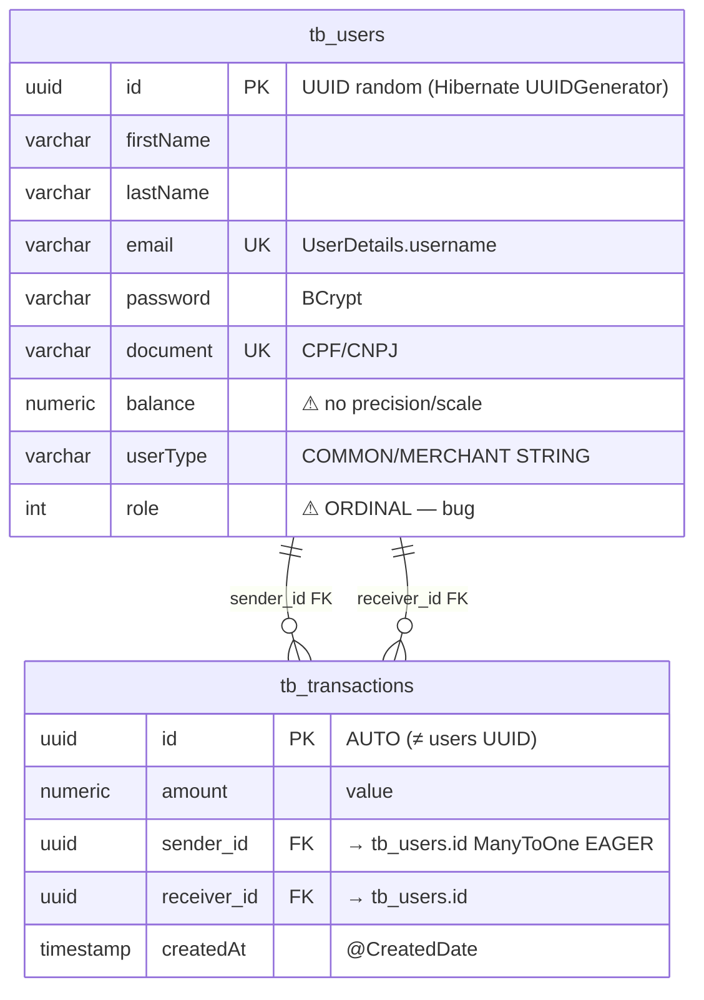

# Data Model — PicPay Payment

> **Source:** `domain/entities/**` · `domain/repositories/**` · `application.properties` (`PostgreSQLDialect`, `ddl-auto=update`) · `docker-compose.yaml` PGDATA

---

## 1. ERD



Interactive version: [diagrams/architecture.html#erd](diagrams/architecture.html#erd)

| Table | PK | FK | UK | Indexes (implicit) |
|---|---|---|---|---|
| `tb_users` | `id uuid` | — | `email`, `document` (`@Column(unique)`) | auto UK indexes; consider composite `(email,document)` + `balance` not indexed |
| `tb_transactions` | `id uuid` | `sender_id`, `receiver_id` → `tb_users.id` | — | FK indexes (Hibernate creates), but no `idempotencyKey` UK |

---

## 2. JPA Mapping Deep Dive

### 2.1 `tb_users` — `domain/entities/user/User.java`

```java
@Entity(name="tb_users") @Table(name="tb_users")
@AllArgsConstructor @NoArgsConstructor @EqualsAndHashCode(of="id")
@Getter @Setter
public class User implements UserDetails {
  @Id @GeneratedValue(strategy = GenerationType.UUID) private UUID id; // Hibernate 6 UUIDGenerator.Random
  private String firstName; // varchar(255) default — add @Column(length=60, nullable=false)
  @Column(unique=true) private String email;
  private String password; // consider @Column(nullable=false, length=60) for BCrypt
  @Column(unique=true) private String document;
  private BigDecimal balance; // ⚠ @Column(precision=19, scale=2, nullable=false)
  @Enumerated(EnumType.STRING) private UserType userType;
  @Enumerated private Role role; // ❌ ORDINAL — fix to STRING
}
```

**Issues & fixes:**

| Field | Current DDL | Recommended | Why |
|---|---|---|---|
| `firstName/lastName/document/email` | `varchar(255)` default | `varchar(60/14/100) not null` + checks | Tighten to real CPF/CNPJ/email lengths |
| `balance` | `numeric` | `numeric(19,2) not null default 0` | Precision prevents rounding & billionaire overflow |
| `role` | `int` (ordinal `USER=0,ADMIN=1`) | `varchar(20) not null` | Reorder enum currently = privilege escalation |
| `password` | `varchar(255)` | `varchar(60) not null` | BCrypt is fixed 60 chars |
| `id` | `uuid not null PK` | add `columnDefinition="uuid"` for portability | And consider ULID for ordering |

`EqualsAndHashCode(of="id")` + mutability → danger if entity in `Set` before persisted (`id==null`). Prefer `EqualsAndHashCode(onlyExplicitlyIncluded=true)` + business key (`email`).

### 2.2 `tb_transactions` — `domain/entities/transaction/Transaction.java`

```java
@Entity(name="tb_transactions") @Table(name="tb_transactions")
public class Transaction {
  @Id @GeneratedValue(strategy = GenerationType.AUTO) private UUID id; // diverges from User UUID
  private BigDecimal amount; // ↔ DTO.value
  @ManyToOne @JoinColumn(name="sender_id") User sender; // default EAGER
  @ManyToOne @JoinColumn(name="receiver_id") User receiver;
  @CreatedDate LocalDateTime createdAt; // from ApplicationAuditAware + @EnableJpaAuditing
}
```

| Concern | Current | Fix |
|---|---|---|
| `id` strategy | `AUTO` vs `User` `UUID` mismatch | Standardize to `GenerationType.UUID` for both |
| `fetch` | `EAGER` default → N+1 when listing transactions | `@ManyToOne(fetch=LAZY)` + `@EntityGraph(attributePaths={"sender","receiver"})` on repo |
| `amount` | unbounded `numeric` | `precision=19,scale=2, nullable=false, check amount>0` |
| `createdAt` | `@CreatedDate` only | Add `@CreatedDate` to User, add `@LastModifiedDate`; consider `Instant` not `LocalDateTime` (TZ) |
| `locking` | none | Add `@Version Long version` → optimistic lock prevents double-spend race |
| `idempotency` | none | Add `String idempotencyKey @Column(unique)` + `status ENUM(PENDING/COMMITTED/FAILED)` |
| `audit` | only `createdAt` | Add `createdBy`, `updatedAt` via `AuditorAware<UUID>` (exists but unused) |

### 2.3 Dialect & Hibernate

`application.properties`:
```properties
spring.jpa.database-platform=org.hibernate.dialect.PostgreSQLDialect
spring.jpa.hibernate.ddl-auto=update
spring.jpa.properties.hibernate.jdbc.lob.non_contextual_creation=true
```
`PostgreSQLDialect` is explicit (good). `ddl-auto=update` is **unsafe for prod** — creates/alters columns without versioning, never drops, no review. Replace with Flyway.

---

## 3. Repositories

```java
public interface UserRepository extends JpaRepository<User,UUID> {
  Optional<User> findByEmail(String email);       // → UserDetailsService
  Optional<User> findByDocument(String document); // → registration uniqueness
}
public interface TransactionRepository extends JpaRepository<Transaction,UUID> {}
```

No paging (`findAll()` returns all), no `@Lock`, no custom `@Query`. Consider `Page<User> findAll(Pageable)`, `@Lock(PESSIMISTIC_WRITE) Optional<User> findByIdForUpdate(UUID)`.

---

## 4. How It Breaks (without fixes)

- **Concurrent double-spend:** Two `POST /transactions` read `balance=100`, both pass `R2`, both subtract 80 → final `balance=-60` (no DB lock). Reproducible with 20 parallel JMeter threads.
- **Enum reorder:** Adding `Role.SUPERADMIN` before `USER` shifts ordinals → existing `0` rows now map to wrong role.
- **DDL drift:** Add `document` UK in code → `update` creates, but dropping column leaves orphan; prod vs H2 diverge.

---

## 5. Target Schema — Flyway Migration Plan

**Step 1** — add `flyway-core` to `pom.xml`, set `spring.jpa.hibernate.ddl-auto=validate`, `spring.flyway.enabled=true`:

```sql
-- V1__init.sql  (extracted from Hibernate generate)
CREATE EXTENSION IF NOT EXISTS "pgcrypto"; -- for gen_random_uuid()
CREATE TABLE tb_users (
  id uuid PRIMARY KEY DEFAULT gen_random_uuid(),
  first_name varchar(60) NOT NULL,
  last_name varchar(60) NOT NULL,
  email varchar(100) NOT NULL UNIQUE,
  password varchar(60) NOT NULL,
  document varchar(14) NOT NULL UNIQUE,
  balance numeric(19,2) NOT NULL DEFAULT 0 CHECK (balance >= 0),
  user_type varchar(16) NOT NULL CHECK (user_type IN ('COMMON','MERCHANT')),
  role varchar(20) NOT NULL CHECK (role IN ('USER','ADMIN')),
  created_at timestamptz NOT NULL DEFAULT now(),
  updated_at timestamptz NOT NULL DEFAULT now(),
  version bigint NOT NULL DEFAULT 0
);
CREATE TABLE tb_transactions (
  id uuid PRIMARY KEY DEFAULT gen_random_uuid(),
  amount numeric(19,2) NOT NULL CHECK (amount > 0),
  sender_id uuid NOT NULL REFERENCES tb_users(id),
  receiver_id uuid NOT NULL REFERENCES tb_users(id),
  idempotency_key varchar(64) UNIQUE,
  status varchar(16) NOT NULL DEFAULT 'COMMITTED',
  created_at timestamptz NOT NULL DEFAULT now(),
  version bigint NOT NULL DEFAULT 0
);
CREATE INDEX idx_tx_sender ON tb_transactions(sender_id);
CREATE INDEX idx_tx_receiver ON tb_transactions(receiver_id);
CREATE INDEX idx_users_email ON tb_users(email);
```

**V2__fix_role_string.sql** (existing data fix for ORDINAL→STRING bug): `ALTER TABLE tb_users ALTER COLUMN role TYPE varchar(20) USING CASE role WHEN 0 THEN 'USER' WHEN 1 THEN 'ADMIN' END;`

---

## 6. See Also

- [Domain](domain.md) — entity behavior & DTOs
- [Architecture](architecture.md) — lifecycle
- [Configuration](configuration.md) — datasource props

