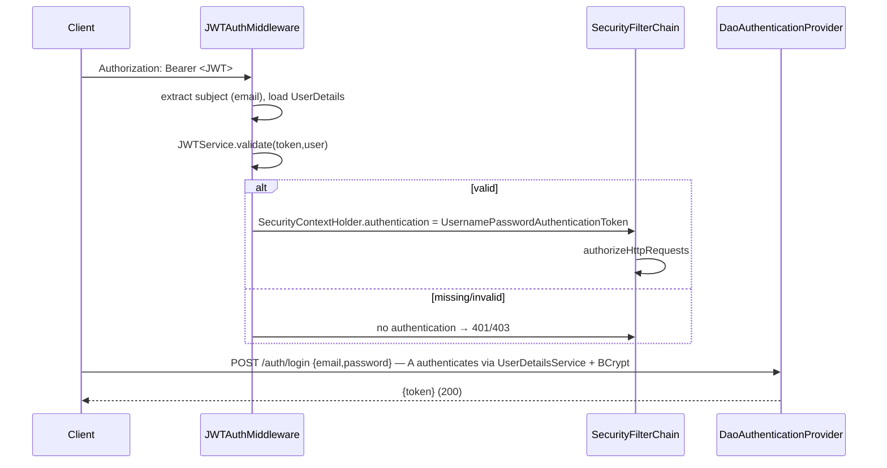

# Security — PicPay Payment

> **Stack:** `spring-boot-starter-security 6.0.x` + `com.auth0:java-jwt 4.4.0` (HMAC256) + `BCryptPasswordEncoder` + stateless `SecurityFilterChain` · **Source:** `infra/config/security/**` · `infra/middleware/auth/JWTAuthMiddleware.java`

---

## 1. Authentication Model

**Type:** stateless JWT Bearer — no session, `SessionCreationPolicy.STATELESS`, `csrf.disable()`. Every request authenticates from `Authorization: Bearer <token>`.

**Flow:**



### 1.1 Login

- `AuthenticateUserUseCaseImpl.authenticate(LoginDTO)` delegates to `AuthenticationManager.authenticate(UsernamePasswordAuthenticationToken(email,password))`.
- `DaoAuthenticationProvider` loads `User` via `UserDetailsService` (by email), checks `BCrypt.matches`.
- On success, `JWTServiceImpl.generateToken(User)` creates JWT; returned as `LoginResponseDTO { token }`.

### 1.2 JWT Contents

| Claim | Value | Notes |
|---|---|---|
| `iss` | `picpay-api` | fixed issuer |
| `sub` | `user.email` | subject = email (unique) |
| `iat` | now | issued-at |
| `exp` | now + **2 hours** | `LocalDateTime.now().plusHours(2).toInstant(ZoneOffset.of("-03:00"))` — hardcoded BRT, no clock injection |
| `alg` | `HMAC256` | `Algorithm.HMAC256("${app.security.token.secret}")` |

**Validation** (`validateToken`): `JWT.require(HMAC256(secret)).withIssuer("picpay-api").build().verify(token).getSubject()` → email; empty on `JWTVerificationException` — filter treats empty as unauthenticated.

---

## 2. Filter Chain

`SecurityConfig.securityFilterChain(HttpSecurity)` (Spring Security 6):

```java
http.csrf(csrf->csrf.disable())
  .sessionManagement(sm->sm.sessionCreationPolicy(STATELESS))
  .authorizeHttpRequests(auth -> auth
    .requestMatchers(WHITE_LIST).permitAll()               // 9 entries
    .requestMatchers(GET,  "/users").hasAnyRole(USER,ADMIN)
    .requestMatchers(POST, "/auth/register").hasAuthority(CREATE_USER)
    .requestMatchers(POST, "/transactions").hasAuthority(EXECUTE_TRANSACTION)
    .requestMatchers(GET,  "/transactions").hasAuthority(READ_TRANSACTION)
    .anyRequest().authenticated())
  .authenticationProvider(authenticationProvider())
  .addFilterBefore(jwtAuthMiddleware, UsernamePasswordAuthenticationFilter.class)
  .logout(logout -> logout.logoutUrl("/auth/logout")
                              .logoutSuccessHandler((req,res,auth)->SecurityContextHolder.clearContext()));
```

- `WHITE_LIST` = `{ "/", "/auth/login", "/v3/api-docs/**", "/api-docs.yaml", "/api/v1/auth/**", "/v3/api-docs.yaml", "/swagger-resources", "/swagger-resources/**", "/configuration/ui", "/configuration/security", "/swagger-ui/**", "/webjars/**", "/swagger-ui.html" }` (note duplicate `/v3/api-docs.yaml`; wildcards `/**`).
- `JWTAuthMiddleware extends OncePerRequestFilter` — reads `Authorization`, strips `Bearer `, calls `JWTService.validate`, loads `UserDetails`, sets `SecurityContextHolder`.
- `BCryptPasswordEncoder` standalone bean; `AuthenticationProvider` uses it.
- `EncryptPasswordBeforeRegisteringUserPolicy` encodes on registration before `SaveUserUseCase`.

---

## 3. RBAC — Roles & Permissions

`domain/entities/auth/Permissions.java` + `Role.java`:

| Role | Permissions | Authorities (strings) |
|---|---|---|
| **USER** | `READ_USER`, `EXECUTE_TRANSACTION`, `READ_TRANSACTION` | `user:read`, `transaction:execute`, `transaction:read`, `ROLE_USER` |
| **ADMIN** | all USER + `DELETE_USER`, `CREATE_USER`, `UPDATE_USER` | …plus `user:delete`, `user:create`, `user:update`, `ROLE_ADMIN` |

`User implements UserDetails` → `getAuthorities()` returns both permissions and `ROLE_*`. So `hasRole('USER')` and `hasAuthority('transaction:execute')` both work. Default registered users are `USER/COMMON`.

**Endpoint → permission map:**

| Endpoint | Required | Who has it |
|---|---|---|
| `POST /auth/register` | `user:create` | ADMIN only |
| `GET /users` | `ROLE_USER` or `ROLE_ADMIN` | any authenticated user |
| `POST /transactions` | `transaction:execute` | USER + ADMIN |
| `GET /transactions` | `transaction:read` | USER + ADMIN |
| `POST /auth/login`, `/` , Swagger | `permitAll` | anonymous |

---

## 4. Password Handling

- **Hash:** `BCryptPasswordEncoder` (strength 10 default) — adaptive, salted. Stored in `tb_users.password`.
- **Policy:** `EncryptPasswordBeforeRegisteringUserPolicyImpl.encrypt(UserDTO)` encodes `dto.password()` before `SaveUserUseCase`. No password strength check beyond `@NotBlank @Size(min=3)`.
- **Leak:** `GET /users` returns entity `User` including `password` hash — **omit**. `POST /auth/register` echoes password. Add `@JsonIgnore` on `password` or return DTO.

---

## 5. Threat Model & Gaps

| Threat | Current | Gap / Fix |
|---|---|---|
| **Brute-force login** | no rate-limit | Add Bucket4j / Spring Retry + `AuthenticationFailureHandler` |
| **JWT theft** | 2h exp, stateless, `localStorage` typical | Shorten to 15m + refresh token; consider `httpOnly Secure` cookie; add blacklist on logout (Redis) |
| **JWT secret exposure** | `${app.security.token.secret}` via `.env` → `@Value` | Ok if `.env` not tracked; rotate every 90d; never log |
| **Logout** | `clearContext()` only | Token remains valid 2h — add revocation list or version claim |
| **CORS** | disabled | Enable explicit `CorsConfiguration` for frontend origins |
| **Secrets in repo** | `.env` gitignored, `.env.example` safe | Correct; add `gitleaks` CI |
| **SQL injection** | JPA + BCrypt, no native queries | Safe |
| **XSS / CSRF** | CSRF disabled (stateless ok), no XSS filter | Add `X-XSS-Protection`, CSP headers |
| **Information disclosure** | `GET /users` leaks hashes + balances | Return projection |
| **Clock skew** | `ZoneOffset.of("-03:00")` hardcoded | Inject `Clock`; use `Instant.now()` |

---

## 6. Headers to Add (prod)

```java
http.headers(h -> h
  .contentSecurityPolicy(csp -> csp.policyDirectives("default-src 'self'"))
  .httpStrictTransportSecurity(hsts -> hsts.includeSubDomains(true).maxAgeInSeconds(31536000))
  .frameOptions(fo -> fo.deny()));
```

Enable CORS if frontend served separately.

---

## 7. See Also

- [API](api.md) — auth endpoints & curl
- [Configuration](configuration.md) — `JWT_SECRET` env var
- [Business Rules](business-rules.md) — merchant/balance validation happens *after* auth
